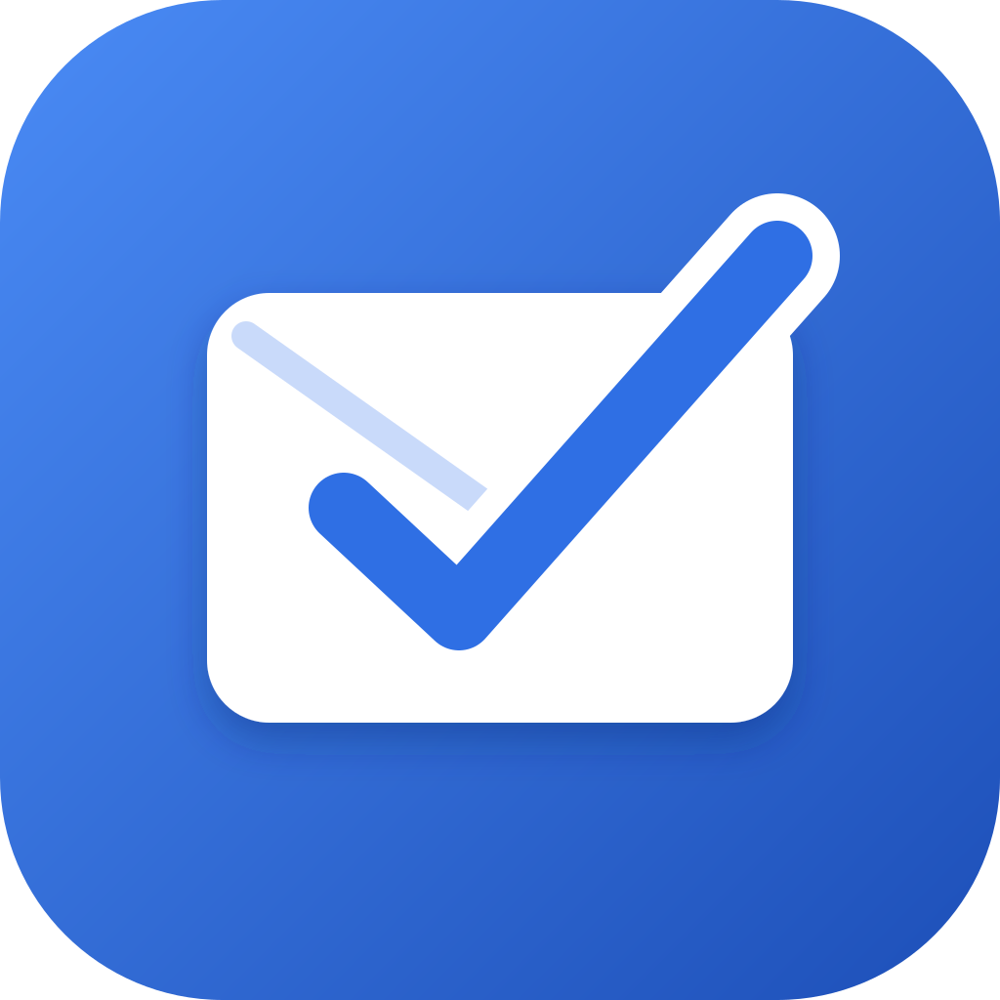
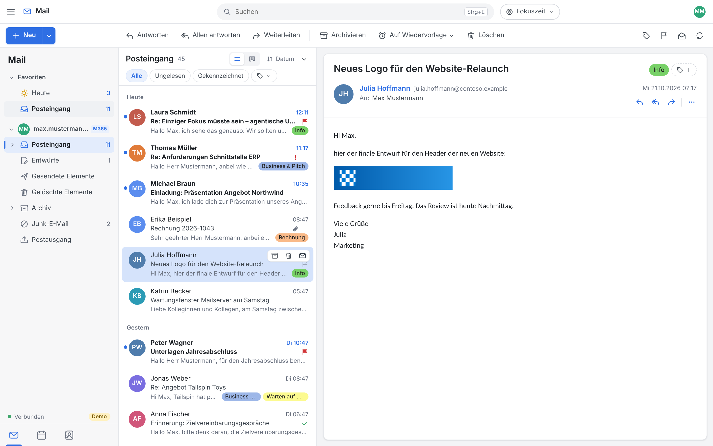
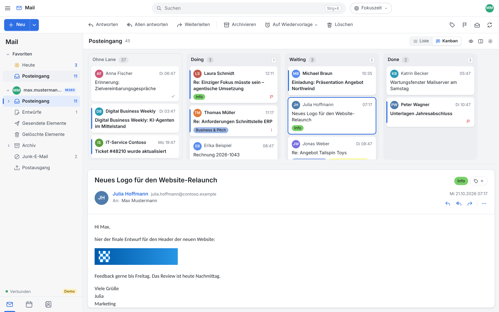
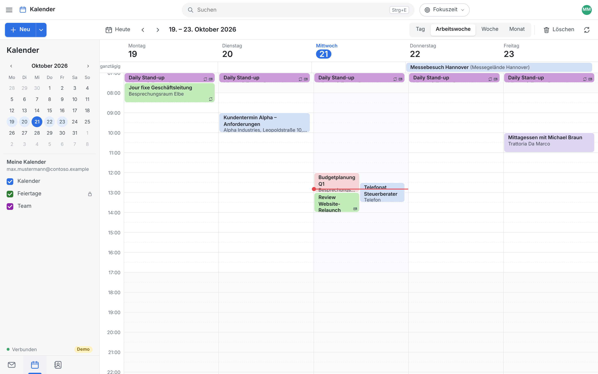

<p align="center">
  
</p>

<h1 align="center">lettertask</h1>

<p align="center">
  <b>Your inbox is your to-do list.</b><br>
  A calm, fast desktop mail client for Microsoft 365, Gmail and IMAP, built for Inbox Zero.
</p>

<p align="center">
  
</p>

## Why lettertask?

Most mail clients are built for reading mail. lettertask is built for **getting through it**.
Each mail is either done, snoozed or on your board, and your inbox stays empty.

- ⏰ **Snooze anything.** A mail leaves your inbox and comes back unread when you need it. Snoozes
  are stored on the server, so they work on all your devices.
- 🗂️ **Kanban for mail.** Drag mails into lanes such as *Doing*, *Waiting* and *Done*. The lanes are
  stored as hidden categories, so they stay compatible with Outlook.
- ✅ **Tasks as mail.** You can create one-off or recurring tasks that show up when they are due.
  You can also add tags such as `#morgen` or `#2w` to the subject when you mail yourself from your phone.
- 🔁 **Follow-up reminders.** You get a reminder if nobody answers, and it clears itself as soon as
  someone replies.
- 🎯 **Focus time.** Fetching new mail pauses for 1–4 hours. The **Today** view shows only what is
  due today.
- ⌨️ **Keyboard triage.** Press `E` to archive, `S` to snooze and `1`–`9` to move a mail to a lane.
- 📅 **Calendar and contacts** for Microsoft 365, including meetings, Teams links and invitations.
- 🔒 **Private by design.** HTML mails render in a sandbox and remote images load only when you
  allow them. Tokens are kept in your OS keychain, and a local cache lets you read offline.

<p align="center">
  
  
</p>

lettertask is written in Rust with Tauri 2 and runs on Windows, macOS and Linux. Microsoft 365
connects through the Graph API, and Gmail through OAuth, so you need no app password. Any other
provider works over IMAP/SMTP with automatic server discovery.

## Try it in 10 seconds (demo mode, no account)

```bash
cargo run -p lettertask -- --demo                 # desktop app
cargo run -p devserver -- --demo --port 8080      # or in the browser: http://127.0.0.1:8080
```

Demo mode runs a built-in fake mail server, and no data leaves your machine.

## Install

Installers for Windows, macOS and Linux are attached to each
[release](https://github.com/symbiosika/lettertask/releases). To build it yourself:

```bash
cargo build --release -p lettertask
cd src-tauri && cargo tauri build   # MSI / DMG / deb / AppImage
```

On Linux you also need `libwebkit2gtk-4.1-dev libgtk-3-dev libayatana-appindicator3-dev
librsvg2-dev libsoup-3.0-dev libssl-dev libdbus-1-dev`.

**Microsoft 365** works right away: just sign in. The default app registration is multi-tenant,
and you can use your own with `LETTERTASK_CLIENT_ID` and `LETTERTASK_TENANT`.
**Gmail** needs a Google OAuth client, which you set up once with `LETTERTASK_GOOGLE_CLIENT_ID`
and `LETTERTASK_GOOGLE_CLIENT_SECRET` or under Settings › Accounts. Enable the **Google Calendar
API** and the **People API** in that client's Google Cloud project: the Google sign-in also brings
in the account's calendars (read and write, Google Meet links, answering invitations) and contacts.
Accounts signed in before this need to sign in with Google once more to grant the new permissions.
You can also add Gmail as a plain IMAP account with an app password (mail only).

## Development

```
ui/               HTML/CSS/ES modules with no build step, served to the WebView
src-tauri/        Tauri shell
crates/core/      OAuth, Graph and IMAP/SMTP, sync, SQLite cache, service API
crates/graph-fake/  stateful Microsoft Graph fake (tests and demo)
crates/devserver/ the same API over HTTP/SSE for browser dev and E2E tests
docs/API.md       contract between the UI and the backend
```

```bash
cargo test --workspace                                       # core, fake server, IMAP (Dovecot)
cd tests/e2e && npm ci && npx playwright test                # UI end-to-end
```

Contributions are welcome. Open an issue or a pull request.

## License

[MIT](LICENSE) © Symbiosika GmbH
